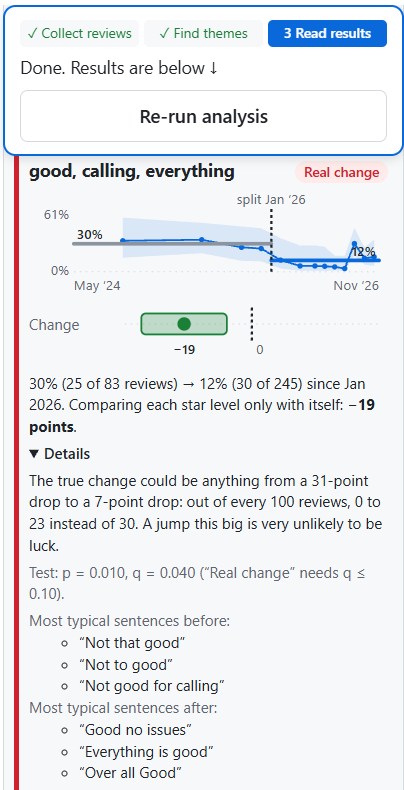
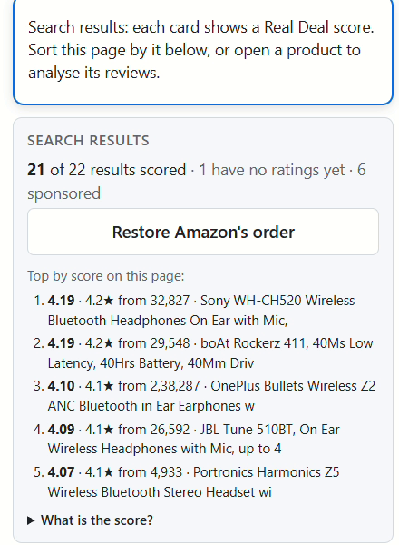
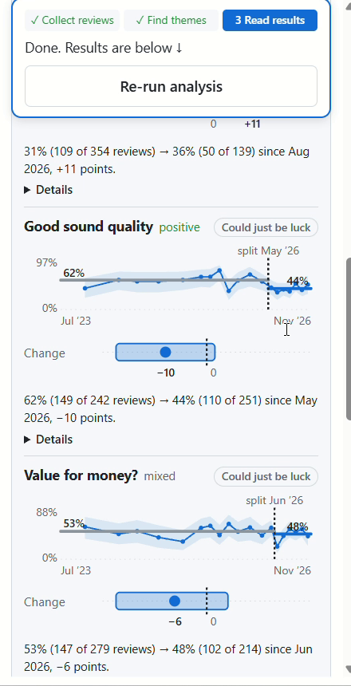
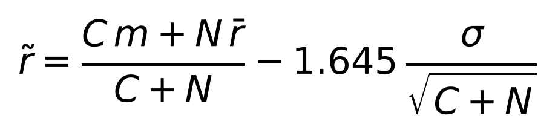
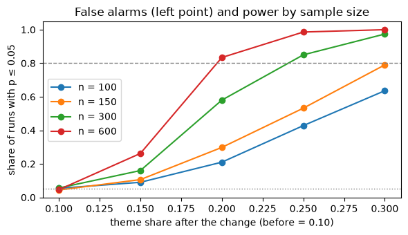
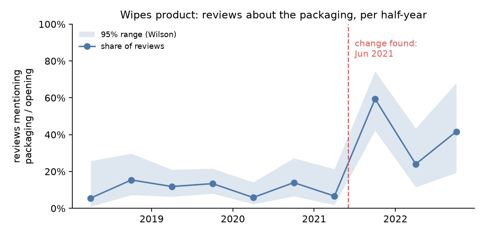

*Medium-friendly copy of [this post](https://saminay786.github.io/posts/2026-11-22-real-deal-amazon-reviews/): no tables, no math markup, one image per row.*

**Code:** [github.com/Saminay786/real-deal](https://github.com/Saminay786/real-deal) (open source, MIT) · **Try it:** [download](https://github.com/Saminay786/real-deal/releases/latest) · **Status:** working prototype (Chrome, amazon.in)

## What this project is about

When you shop online, a product's star average and a few top reviews have to answer two questions:

1. **How sure can I be about that average?** 4.4★ from 22 ratings and 4.4★ from 11,000 ratings are not the same evidence.
2. **Does it still describe the product sold today?** Products change: a new supplier, a new formula, new packaging. A 4.5★ average built over four years can hide a product that got worse last spring.

**Real Deal** is a Chrome extension for amazon.in that answers both. It reads the reviews you open, groups their sentences into themes ("battery life", "missing pieces in the box"), and tests whether each theme's share of reviews **really changed** or **could just be luck**.

Everything runs **inside your browser**: the language model, the statistics and the storage. The extension makes no network requests, and Chrome enforces that.

**What to expect:** what the extension shows, the statistics behind each part, how I checked the method on real Amazon data, and what went wrong along the way.

## What it shows

- **Product page:** `likely 3.8–4.7 · low data` next to the stars, showing how uncertain the average is.
- **Side panel, themes over time:** what reviewers talk about, and whether each theme's share changed. Every theme gets a verdict.
- **Search results:** a cautious score on every result, and "sort this page", so you see which ratings you can trust, not just which are highest.
- **Side panel, review pattern check:** unusual floods of reviews. These are *signals* worth reading about, never "fake".

{fig-alt="Side panel card for the theme 'good, calling, everything' marked Real change: monthly share drops from 30% to 12% at a dashed line in January 2026; change box from -31 to -7 points, entirely left of zero; typical sentences before are 'Not that good', 'Not good for calling', after are 'Good no issues', 'Everything is good'."}

{fig-alt="Side panel listing search results scored, a 'Restore Amazon's order' button, and the top 5 products by score, e.g. 4.19 for a 4.2-star product with 32,827 ratings."}

## How it works

### 1. How sure is the average?

The product page shows the share of 1★ to 5★ ratings and the number of ratings. From them I rebuild the counts and treat the true star shares as unknown, with a **Dirichlet posterior** (a Jeffreys prior, α = 0.5 for each star level). Drawing 4,000 samples of the average gives a 90% range: `likely 3.8–4.7`.

I tried a uniform prior first. On products where almost every rating is 5★, its "90%" range held the true value only 74% of the time in simulation. The Jeffreys prior brought that to 88–91%.

### 2. What do reviewers talk about?

- Reviews are split into sentences. Hinglish and page junk ("The media could not be loaded") are removed.
- Each sentence becomes a vector using **all-MiniLM-L6-v2**, a 23 MB sentence model that runs in a Web Worker inside the extension.
- **Spherical k-means** groups similar sentences. The number of themes (3 to 8) is chosen by the silhouette score.
- **c-TF-IDF** (the labelling idea from BERTopic) finds each theme's keywords. If Chrome's built-in **Gemini Nano** is available, it turns them into a readable name. The name is kept only if it uses the theme's own keywords.

A review "mentions" a theme if any of its sentences falls into it. That gives, for each theme and month, *k of n reviews mentioned it*.

### 3. Did the theme's share change?

For every month boundary, the test compares the share before and after with a **binomial likelihood ratio** and keeps the largest. Searching every month for the biggest difference will always find *something*. So the p-value comes from a **permutation test**: shuffle which reviews mention the theme 999 times, redo the whole search each time, and see how often chance alone produces a difference this large.

A product has several themes, so several tests run at once. **Benjamini–Hochberg** controls the false-discovery rate across them. A theme is shown as **Real change** only if q ≤ 0.10.

**The star-filter trap.** Amazon shows at most 100 reviews per sort or filter. To reach older reviews, you have to open filters like "1★ only". But if the later months come mostly from the 1★ filter, every complaint theme seems to "rise". In those cases the test switches to a **Cochran–Mantel–Haenszel** version that compares 1★ reviews only with 1★ reviews, 5★ only with 5★, and so on.

The Sony headphones below show why this matters. "Good sound quality" fell from 62% to 44% of reviews, which looks dramatic. But much of the recent sample came from the 1★ filter. Compared like with like, the drop is no larger than chance would produce, so the verdict is **Could just be luck**.

{fig-alt="Side panel showing themes 'Good sound quality' and 'Value for money?', each with a sparkline of monthly share, a change range bar crossing zero, and the verdict 'Could just be luck'."}

**What a real change looks like.** On the Realme neckband shown earlier, short verdicts about the product fell from 30% to 12% of reviews after January 2026: −19 points, with a likely range of −31 to −7 that stays well away from 0 (q = 0.04). The typical sentences show what moved: *"Not good for calling"* before, *"Everything is good"* after. The test can't say *why*: a fix to call quality, or a change in who reviews. It also shows a known weakness. This theme mixes "good" and "not good", because sentence vectors group by topic more than by opinion.

### 4. Search results: which rating can you trust?

Sorting by average rating puts 5.0★ from 3 ratings above 4.3★ from 2,000. Instead, each result gets

{fig-alt="Score equals (C times m plus N times average rating) divided by (C plus N), minus 1.645 times sigma divided by the square root of (C plus N)."}

a rating pulled towards a typical one, then lowered by its uncertainty. I estimated the constants from the research data: typical rating m = 3.98★, per-review spread σ = 1.34, prior weight C ≈ 5 ratings. So 4.6★ from 9 ratings scores about 3.79, while 4.3★ from 2,000 scores about 4.25. "Sort this page" reorders only the current page. It never loads more.

### 5. Unusual floods of reviews

The check finds the busiest 14-day window and asks how likely that many reviews would be at the product's usual pace, using a Poisson tail corrected for having searched every window. It reports a signal only if the burst is very unlikely (p < 0.001) **and** those reviews were also clearly more positive or more often unverified than the rest.

## Does it work? Checking on real data

I checked the method in a Python notebook on the **McAuley Lab Amazon Reviews 2023** dataset (All_Beauty; Hou et al., 2024), running the same steps as the extension, with sentence embeddings computed on a laptop GPU.

**False alarms and power.** In simulation, with a theme at 10% of reviews:

{fig-alt="Line chart: share of runs with p ≤ 0.05 versus theme share after the change, for 100, 150, 300 and 600 reviews. All start near 5% with no change; at 25% after, detection is 43%, 53%, 85% and 99%."}

The false-alarm rate stays near 5% at every size. With 300 reviews, a rise from 10% to 25% is caught 85% of the time. With 100 reviews, only 43% of the time. So **"Could just be luck" with about 100 reviews means "not enough reviews to tell"**, not "nothing changed". The panel says so.

**A real product change, found at the right month.** Across 50 products with long histories, the test flagged 86 theme changes in 33 products. The clearest was a pack of wipes. A theme about *packaging, new, open* rose from 8% to 40% of reviews from June 2021 (q = 0.008). I then read the reviews: *"They changed the packaging. They no longer use the good snap shut packaging"*, and *"New packaging awful… Impossible to open!!!"*

{fig-alt="Line chart: share of reviews mentioning packaging stays between 5% and 15% from 2018 to early 2021, then jumps to about 60% in late 2021, after a dashed line marking the June 2021 change."}

**Not every detected change is a product change.** Reading the other flagged products, I found changes in who buys the product (a spray bottle that went from "curly hair" to "plant misting" reviews), shifts in reviewing culture (incentivized reviews before Amazon's 2016 ban), and listings that bundle several products. The statistics can say *that* something changed. Only reading can say *what*. That's why every theme in the panel shows its most typical sentences.

**A suspicious burst.** One eye cream received 109 reviews in 14 days, against a usual pace of about 3. Those reviews averaged 4.81★ against 4.27★, and 99% were unverified against 34%. This is exactly the pattern the Review pattern check looks for. It's still a *signal*, not proof.

## What went wrong, and what it taught me

I logged every problem, why it happened, and why my tests didn't catch it earlier: 53 entries so far. A few that changed the design:

- **"Collect everything" isn't possible.** Amazon shows at most 100 reviews per sort or filter. The extension now works through filters, merges them without duplicates, and shows how much of the history it holds ("493 of 7,469 reviews, 40 months").
- **Stratifying all the time hid real changes.** The star-level test is less powerful, so it now runs only when filtered views were used *and* the collection is incomplete.
- **A small language model fails in quiet ways.** Gemini Nano sometimes added numbers that weren't in the results, wrote "over 100" for 87, or turned "fell" into "rose". Every summary is now checked against the test results: each number must appear there, and no change can be claimed when none is significant. If a check fails, a plain template is used instead.
- **Statistics people can read.** Early versions showed p, q and Δ. Most people can't use those. The panel now shows a verdict (**Real change**, **Could just be luck**, **Not proven**), a monthly chart and one plain sentence with the counts. The numbers are under "Details".
- **Present in the page isn't the same as visible.** The search score badges passed every test but weren't visible in Chrome: Amazon clips the title link they were placed in. Tests on saved pages can't see CSS.

## Is this new?

The building blocks are established, and this project applies them rather than inventing them:

- **c-TF-IDF topic labels:** Grootendorst, *BERTopic* (2022).
- **Change-point tests with permutation p-values:** a standard non-parametric approach for scanning statistics.
- **False-discovery rate:** Benjamini & Hochberg (1995).
- **Shrinking ratings with few votes:** the Bayesian average used by many ranking systems, here with a lower confidence bound and constants estimated from data.

Existing tools answer different questions. Amazon's "Customers say" summarises reviews, but has no time dimension and no uncertainty. Fakespot (shut down in 2025) and ReviewMeta graded authenticity on their own servers. Keepa tracks price history, not reviews.

What Real Deal adds is the combination: **per-theme change tests over time, with false-discovery control and a fix for Amazon's star filters, running entirely on-device**, and explained in plain language.

## Try it yourself

Real Deal is open source, and you can install it without any coding:

1. Download `real-deal-v0.1.0.zip` from the [latest release](https://github.com/Saminay786/real-deal/releases/latest) on GitHub.
2. Unzip it and keep the `real-deal` folder somewhere permanent.
3. In Chrome, open `chrome://extensions`, turn on **Developer mode**, click **Load unpacked** and choose the folder.

Then open any product on amazon.in and click the Real Deal icon. A box at the top of the side panel always shows the next step. The [user guide](https://github.com/Saminay786/real-deal/blob/main/docs/USER_GUIDE.md) walks through installing, collecting reviews and reading the results, with screenshots.

## Limitations and next steps

- It sees only the reviews you open, and Amazon decides which 100 reviews each view shows.
- About 100 reviews only detect large shifts.
- Failures can rise over time as units age, even if the product hasn't changed.
- A theme can merge two related topics.
- Hindi and Hinglish reviews are skipped, because the model is English-only.

Next, I'd add a multilingual model for Hindi and Hinglish, split themes that merge two topics, and support Flipkart.

**The takeaway:** a star average is one number standing in for years of changing experiences. Asking *how sure* and *since when* turns it into something you can actually decide with, and both questions can be answered on your own computer.

The formulas, the validation notebook and the full log of decisions are in the [GitHub repo](https://github.com/Saminay786/real-deal).

---

*Data: Hou, Y., Li, J., He, Z., Yan, A., Chen, X. & McAuley, J. (2024). Bridging Language and Items for Retrieval and Recommendation. arXiv:2403.03952. The dataset is shared for research and isn't redistributed here.*

*Real Deal is an independent personal project, not affiliated with or endorsed by Amazon. Amazon is a trademark of Amazon.com, Inc.; other product and brand names belong to their owners. The extension only reads pages you open. Its one automated action, "Load this view", runs only when you press it, clicks Amazon's own "Show 10 more" button every 2–4 seconds and stops at Amazon's limit. Results are signals to read further, never verdicts that a product or review is fake.*
