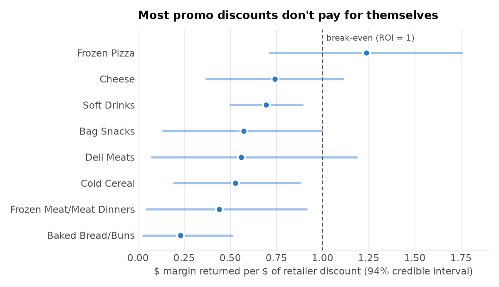
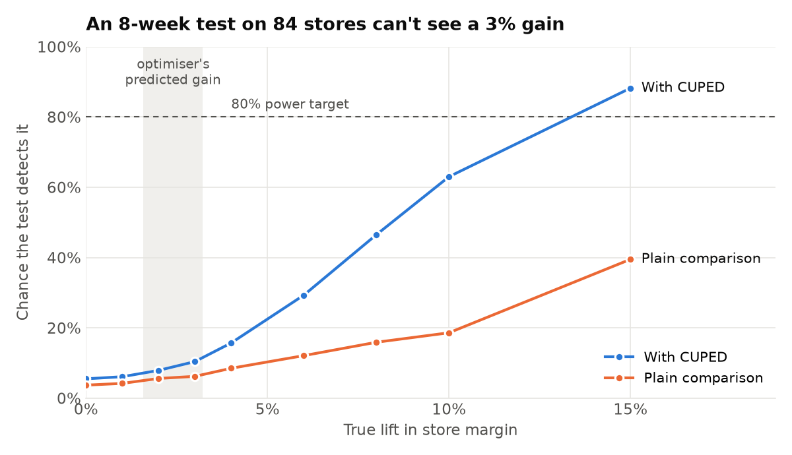

**Code:** [github.com/Saminay786/promo-optimization-engine](https://github.com/Saminay786/promo-optimization-engine)

## The 20%-off puzzle

A box of cereal goes **20% off** and sales double, from 100 boxes to 200. Success?

Maybe not. That same week, the cereal was probably also on the **front of the weekly flyer** and on a **display at the end of the aisle**. Some of those 200 boxes would have **sold anyway**, just at a lower price. And some shoppers simply **switched** from the cereal next to it.

"Sales went up during the promo" mixes all of that together. Plan from it, and you keep paying for discounts that don't earn their cost.

I used **dunnhumby's *The Complete Journey***, two years of real grocery shopping from about 2,500 households, to pull these apart in four steps:

| Step | Question | Method |
|---|---|---|
| **1. Measure** | How much extra does a discount actually *cause*? | Double Machine Learning |
| **2. Plan** | Which product gets which discount, in which week? | Integer optimisation |
| **3. Cross-check** | Does the whole-category view agree? | Bayesian marketing mix model |
| **4. Test** | Could a store test prove it works? | A/B test simulation |

## Step 1: What does a discount really cause?

I built a weekly history for the **137 top-selling products** over 99 weeks. Then I asked: in weeks when the discount was deeper than usual, *beyond what the flyer, display, season and recent sales would explain*, did sales rise more than expected? That's the idea behind **Double ML**: strip out everything else first, so the discount only gets credit for what's left.

| | Effect (θ) | What 10% off does |
|---|---|---|
| Naive: promo weeks vs. normal weeks | 3.49 | +42% units |
| **Double ML: other factors removed** | **2.51** (95% CI 2.18–2.85) | **+29% units** |
| Placebo: discounts randomly shuffled | 0.01 | nothing, as it should |

The naive view overstates the discount by about **40%**, because it gives the discount credit for the flyer and display's work. And **44% of promo-week sales would have happened anyway.**

## Step 2: Plan the promo calendar

For 8 weeks with 10 promo slots a week, which product should get 10%, 20% or 30% off, and when? The rules interact (a budget, a cap per category so cereals don't steal from each other, no back-to-back weeks so shoppers don't just stock up), so I set it up as an **integer program** and let a solver (OR-Tools CP-SAT) find the best combination.

The comparison is a common rule of thumb: *deepest discount on the best sellers*. Same rules, same $5k budget:

| | Extra margin | Budget used |
|---|---|---|
| "Deepest discount on top sellers" | $60 | all of it |
| **Optimised calendar** | **$719** | 37% less |

The rule of thumb loses because **30% off only pays for itself on about 1 in 4 products**. On the rest, the discount given on sales that would have happened anyway outweighs the extra sales. The solver saves deep discounts for products that respond strongly, like beer and soft drinks.

## Step 3: Zoom out to the whole category

Step 1 looked at products one at a time. As a check, I modelled weekly sales for **8 whole categories** with a **Bayesian marketing mix model** (PyMC-Marketing). It has three levers (discount, flyer and display), and it allows for effects that linger a week or two and for diminishing returns.

{fig-alt="Dot-and-interval chart of discount ROI for 8 grocery categories. Only frozen pizza has a mean above the break-even line of 1 (1.24); the others range from 0.23 for bread to 0.74 for cheese."}

- **Most discounts don't pay for themselves.** In 7 of 8 categories, each $1 of discount brings back less than $1 of margin. Soft drinks return about $0.69. Only frozen pizza clears break-even.
- **The twist:** both models rank the categories the same way, but the category-level effect is only **about half** the product-level one. That's what **cannibalisation** looks like: when one cereal is discounted, part of its jump is taken from the cereal next to it. The category total rises by less than the product does.
- **So Step 2's $719 is probably about twice too high.** The *comparison* still holds, since both plans use the same estimates, but the dollar figure is optimistic.

## Step 4: Could a store test even prove it?

A prediction isn't proof. So I designed the test a retailer would run: split stores 50/50, run the new calendar in half, and compare weekly promo margin, using **CUPED** (adjusting for how each store did before the test) to cut the noise. Then I simulated it **1,000 times on real store history**:

{fig-alt="Line chart of test power versus true lift. With CUPED, power rises from 5% at no lift to 63% at 10% and 88% at 15%; without CUPED it only reaches 40% at 15%. The optimiser's predicted gain of 1.6 to 3.2% sits where power is about 10%."}

- **The test is fair:** with no real change, it raised a false alarm about 5% of the time, exactly as designed.
- **But it's too small.** With 84 usable stores, it reliably detects only lifts of about **13% or more**. The calendar is expected to add about **3%**, and this test would catch that only about **10%** of the time.
- **CUPED roughly triples** the chance of catching a real effect.

So a "not significant" result **wouldn't mean the calendar failed**, only that the test couldn't see it. Proving a 3% lift would need about 1,500 stores, a longer test or a less noisy metric. Much better to know that *before* running it.

## What I'd tell a promo team

1. **Judge a promo by the sales it creates, not the sales it records.** Almost half of promo volume was going to happen anyway.
2. **Deeper isn't better.** Most categories lost money on deeper discounts. Save them for the few products that really respond.
3. **Check product-level wins at category level.** Part of every "uplift" is stolen from the shelf next to it.
4. **Size the test before you run it.** Otherwise a "no effect" result can kill a good idea.

## Limitations

The data is observational, so the Double ML result holds only if I've measured what drives both promo decisions and sales. There's **no cost data**: margin (30% of price), supplier funding (50% of the discount) and display costs are assumptions. Cannibalisation and stock-piling are handled with simple rules. And with only a 2,500-household panel, a real retailer's full store sales would make the test far more powerful.

**Next:** scale product-level effects to category level before optimising, model stock-piling directly, and compare other test designs, such as alternating weeks.

Full code, results and every number above are in the [GitHub repo](https://github.com/Saminay786/promo-optimization-engine).
