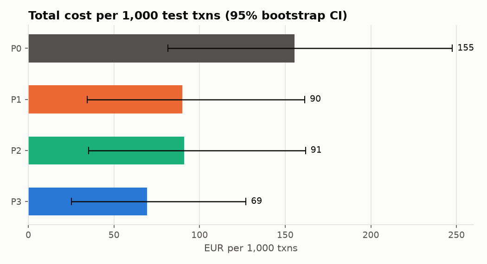
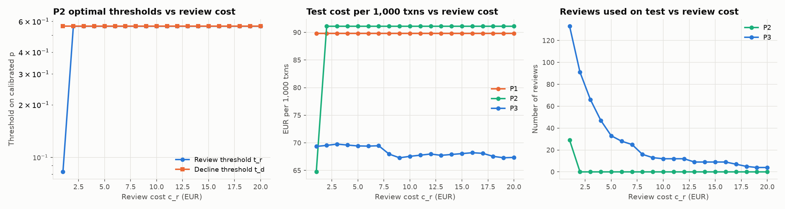
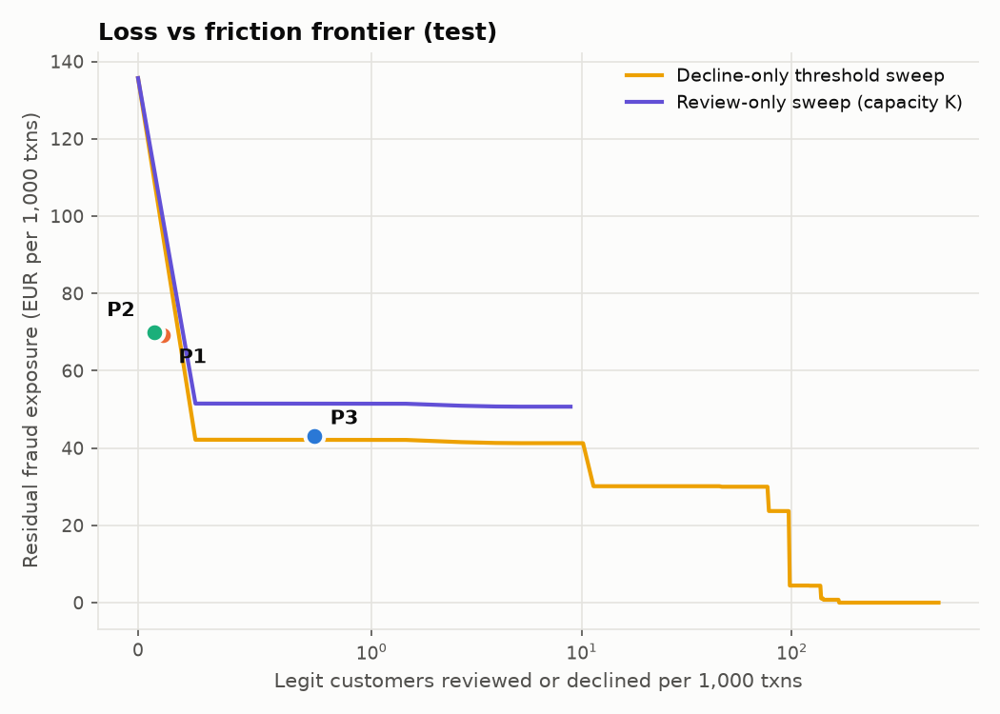

**Code:** [github.com/Saminay786/transaction-risk-decision-framework](https://github.com/Saminay786/transaction-risk-decision-framework) · **Status:** in progress

## Two transactions, same score

Two card payments arrive at the same moment. One is a **€3 coffee**. The other is a **€900 laptop**. The fraud model gives both the same score: a **10% chance of fraud**.

The most common rule in fraud tutorials is "decline if the score is above 0.5". By that rule, both are approved, because 10% is well below 50%.

But look at what's at stake:

- If the coffee is fraud, the bank loses about €3.
- If the laptop is fraud, the bank loses €900 plus chargeback fees.

Having an analyst check the laptop costs around €5. That's clearly worth it. Checking the coffee isn't.

**The same score can call for different decisions.** A fraud model tells you *how risky* something is. It doesn't tell you *what to do about it*. This project is about that second step.

Here's what I found:

- **Picking the cheapest action for each transaction beats a fixed cut-off.** On the test period it cut total cost from **€89.8 to €69.4 per 1,000 transactions** and stopped **68%** of fraud € instead of 49%.
- **The data is thin, so I report how sure I am.** With only 75 frauds in the test window, the saving against the 0.5 rule could be anywhere from **−€352 to €3,493** (95% interval). It points the right way, but it isn't proven yet.
- **Fine-tuning a cut-off on a few frauds backfired.** A carefully tuned two-threshold rule did slightly *worse* than the plain 0.5 rule on new data.

## Where this started

I first worked on fraud during my Master's at IIT Madras, on **Credit Default and Fraud Risk Prediction** (American Express – IIT Madras, 2022). That was a classic modelling project. I cleaned the data, filled gaps with KNN imputation, balanced the classes with SMOTE-Tomek, and compared seven models with stratified K-fold cross-validation. XGBoost won on ROC-AUC and F1.

Looking back, that project stopped at the question *"how risky is this case?"* A risk team has to go one step further: *"so what do we do, and what will it cost?"* This project picks up from there.

## Three choices, each with a price

For every transaction, a card issuer can do one of three things. Each choice has a cost if it turns out wrong:

| Action | If it's fraud | If it's legit |
|---|---|---|
| **Approve** | the bank loses the amount + chargeback fees | no cost |
| **Review** (an analyst checks it) | analyst time; most fraud is caught | analyst time + a delayed customer |
| **Decline** | fraud stopped | lost sale + an annoyed customer |

There's one more real-world limit: **analysts are limited.** You can't review everything, so reviews have to go where they matter most.

That turns the problem into: *for this transaction, given its risk and its amount, which action is cheapest, and do we still have review capacity?*

## How I built it

**The data.** I used the public ULB credit-card dataset: 284,807 European card transactions over two days, of which 492 (0.17%) are fraud. The features are anonymised, which suits this project. The interesting part here is the decision, not the features.

**Step 1: split by time, like real life.** In practice you train a model on the past and use it on the future. So I trained on the first 60% of the timeline, tuned on the next 20%, and kept the last 20% as an untouched test period. Random splits would quietly let the model "see the future".

**Step 2: a plain model, but with trustworthy probabilities.** I used LightGBM, a standard choice. The important change from my 2022 project: **no SMOTE this time.** Resampling helps F1, but it makes the model think fraud is far more common than it is, so a "10%" score no longer means 10%. Here the probability goes straight into a € calculation, so it has to be honest. I checked this with calibration (Platt scaling vs isotonic regression) on held-out data.

**Step 3: put a price on each action.** With *p* = fraud probability and *A* = transaction amount:

```
cost(approve) = p × (A + chargeback fees)
cost(review)  = analyst cost + p × (share analysts miss) × (A + fees) + (1 − p) × customer delay
cost(decline) = (1 − p) × (lost margin on A + cost of an annoyed customer)
```

For the laptop at 10%, that gives about **€92 to approve, €15 to review, €33 to decline**, so it goes to review. For the coffee: **€1.80 to approve**, more for anything else, so it goes through.

The costs behind these formulas are assumptions I set in one config file: €5 per review, analysts catch 90% of fraud, €15 chargeback fees, 3% lost margin + €10 per wrongly declined customer, €1 delay cost per reviewed legit customer, and reviews capped at 1% of transactions. In a real bank, Finance and Operations would supply these numbers.

**Step 4: compare four ways of deciding** on the same test period:

| Policy | How it decides |
|---|---|
| **P0** | approve everything (to see what doing nothing costs) |
| **P1** | decline if p > 0.5 (the common default) |
| **P2** | two cut-offs, one for review and one for decline, tuned on past data |
| **P3** | for each transaction, pick the cheapest action; respect the review cap |

## What happened

{fig-alt="Horizontal bar chart of cost per 1,000 transactions: approve-all €155, P1 €90, P2 €91, P3 €69, with wide overlapping error bars."}

Doing nothing (P0) costs €155 per 1,000 transactions. The standard 0.5 rule (P1) cuts that to €90. Choosing per transaction (P3) brings it down to **€69**.

| | P1: decline if p > 0.5 | P3: cheapest action |
|---|---:|---:|
| Cost per 1,000 transactions | €89.8 | **€69.4** |
| Share of fraud € stopped | 49.0% | **68.2%** |
| Fraud € still getting through | €3,941 | **€2,455** |
| Analyst reviews used | 0 | 33 (out of 569 allowed) |

Where does the gain come from? Exactly the coffee-and-laptop situation. P3 spends a few analyst reviews on risky, *expensive* transactions that the 0.5 rule would have waved through. It needed only 33 reviews to do it, far below the cap.

## Can we trust the gain?

Here the honest answer is "partly". The test window has only **75 frauds**, and a single big fraud can move the totals a lot.

To measure that uncertainty, I resampled the test period 1,000 times and recalculated each time:

- P3 is cheaper than approving everything in **99.7%** of resamples. That part is solid.
- P3 is cheaper than the 0.5 rule in **85%** of resamples. That's encouraging, but the 95% range for the saving still includes zero.

So I wouldn't present this as "P3 saves €1,162". I'd present it as **a strong case for a shadow pilot**: run P3 alongside the current rule, without acting on it, and measure.

## A surprise: tuning made things worse

P2 is what many teams would try first: keep simple cut-offs, but tune them on past data. I tuned them on the validation period, which had only **33 frauds**. The best setting it found was "decline above 0.56, never review". On the test period, that did slightly worse than the plain 0.5 rule.

With so few frauds, tuning mostly fits noise. P3 sidesteps this because **it has no cut-offs to tune.** It only needs honest probabilities and the cost assumptions. When fraud labels are scarce, which they usually are, that's a real advantage.

## What if analysts cost more?

The €5 review cost is a guess, so I re-ran everything with review costs from €1 to €20:

{fig-alt="Three panels. P2 thresholds are flat except at €1 review cost. P3 cost per 1,000 stays between €67 and €70 while P1 is €90. P3 reviews fall from 133 at €1 to 4 at €20."}

P3 adapts on its own. Cheap reviews: it uses more of them (133 at €1). Expensive reviews: it saves them for the riskiest cases (just 4 at €20). Its total cost stays between €67 and €70 throughout, against €90 for the 0.5 rule.

One exception I want to be upfront about: at €1 per review, the tuned P2 does beat P3.

## The trade-off a risk leader actually manages

In the end, every fraud policy balances two things: **fraud let through** and **good customers inconvenienced**. Plotting one against the other shows where each policy sits:

{fig-alt="Frontier chart: residual fraud exposure falls as more legit customers are reviewed or declined. P1 and P2 sit at low friction and higher losses; P3 sits lower with slightly more friction."}

P3 accepts a little more friction (about 0.75 good customers per 1,000 reviewed or declined) to cut fraud let through by about 38% compared with the 0.5 rule. Whether that's the right balance is a business call. The point is that the chart makes the choice visible.

## What this doesn't tell us

- **Few frauds.** 75 in the test window, so all the ranges are wide.
- **The costs are assumptions.** Change them and the ranking can change.
- **Two days of anonymised data.** No seasonality, and no card or customer IDs, so the same card could appear in both training and testing.
- **Instant labels.** Here we know right away which transactions were fraud. In real life, chargebacks take weeks to arrive.

## Where it goes next

- Apply the same decision layer to the larger **IEEE-CIS** fraud dataset, split by customer so no one appears in both training and testing.
- Simulate **delayed labels** to see how quickly a policy goes stale.
- Estimate how well analysts catch fraud at different risk levels, instead of assuming 90% everywhere.

Back to the coffee and the laptop. A good fraud model gives them the same score, and that's fine. Its job is to estimate risk. **Deciding what to do with that risk is a separate job**, and it's where most of the money is.

The full write-up, with all formulas, the assumptions table and a one-page decision memo, is in the [GitHub repo](https://github.com/Saminay786/transaction-risk-decision-framework).
