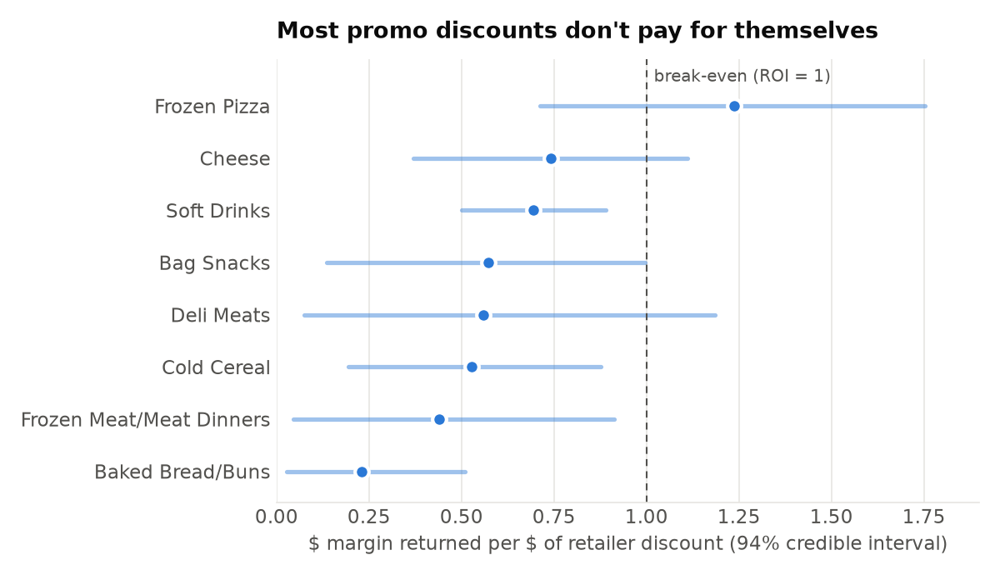
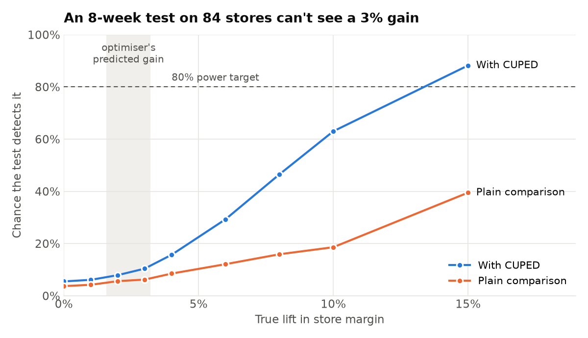

**Code:** [github.com/Saminay786/promo-optimization-engine](https://github.com/Saminay786/promo-optimization-engine)

**TL;DR:**

- **Discounts work, but less than they appear to.** After controlling for displays, mailers and seasonality, the effect drops by about 30%, and 44% of promo volume would have sold anyway.
- **Planning with corrected numbers pays.** An optimised promo calendar beats the usual "deepest discount on top sellers" rule on the same budget.
- **At category level, most discounts don't pay for themselves** (7 of 8 categories).
- **The predicted gain is too small to prove with a store test of this size.** That changes how a "no effect" result should be read.

## The problem

Retailers spend a lot on promotions. The common way to judge them is "units sold during the promo vs. a normal week". That number mixes up three things: the discount itself, the display or mailer that usually comes with it, and sales that would have happened anyway. Plan from it, and you over-invest in discounts.

The project works through four questions in order:

| Step | Question | Method |
|---|---|---|
| **1. Measure** | How much extra volume does a discount actually *cause*? | Double Machine Learning |
| **2. Decide** | Which product should get which discount, in which week? | Integer optimisation (CP-SAT) |
| **3. Cross-check** | Does a top-down view agree? | Bayesian marketing mix model |
| **4. Test** | How would we prove it works in real stores? | A/B test design: power simulation + CUPED |

**Data:** dunnhumby's *The Complete Journey*, with two years of grocery transactions from ~2,500 households plus display and mailer data. I used the **137 top-revenue products over 99 weeks** (11,892 product-weeks), excluding fuel, gift cards and miscellaneous items.

## 1. Measure: what does a discount really cause?

I built a product × week panel. The *treatment* is discount depth. The *controls* are display/mailer exposure, past sales, seasonality and how much else in the category was on promo. I then estimated the effect with Double ML (EconML `LinearDML`, LightGBM, 5-fold cross-fitting) and compared it with a naive estimate and a placebo test.

| | Elasticity θ | What 10% off does |
|---|---|---|
| Naive (no controls) | 3.49 | +42% units |
| **Double ML** | **2.51** (95% CI 2.18–2.85) | **+29% units** |
| Placebo test | 0.01 | no effect, as expected |

About **43.8% of promo volume was non-incremental**. Those were sales the retailer would have made anyway.

## 2. Decide: build the promo calendar

The per-category effects feed an integer program (OR-Tools CP-SAT). It picks a discount (10/20/30% or none) for each product-week, subject to a budget, weekly promo slots, a frequency cap, a per-category cap and no back-to-back promos. I compared it with a common rule of thumb: deepest discount on the top sellers.

Same $5k budget, 8 weeks, 10 promo slots per week:

| | Incremental margin | Budget used |
|---|---|---|
| "Deepest discount on top sellers" | $60 | full |
| **Optimised calendar** | **$719** | 37% less |

The rule of thumb loses mostly because it puts deep discounts on products that would sell anyway. Treat the absolute dollar figure with caution: step 3 suggests it's overstated.

## 3. Cross-check: the category view

As a top-down check, I modelled weekly *category* sales for 8 categories with a Bayesian marketing mix model (PyMC-Marketing). It has three levers (discount rate, mailers, displays) and accounts for carryover and diminishing returns.

{fig-alt="Dot-and-interval chart of discount ROI for 8 grocery categories. Only frozen pizza has a mean above the break-even line of 1 (1.24); the others range from 0.23 for bread to 0.74 for cheese."}

- Discount ROI is **below 1 in 7 of 8 categories**. Soft drinks return about $0.69 per $1 of discount. Only frozen pizza is above break-even (1.24), and even there the interval is wide.
- Displays look cheap to break even on (roughly $0.005–0.08 per placement). That hints at moving some discount money into displays, depending on costs I don't have.
- **Both models rank the categories the same way.** But the category-level effect is only **43–55%** of the product-level one for bread, cheese and soft drinks (19% for deli meats). That fits with discounts partly stealing sales from other products in the same category (cannibalisation). So the optimiser's gain is probably about half what step 2 says.
- Model health: 0 divergences, max r-hat 1.008, R² 0.44–0.64 for 7 of 8 categories.

## 4. Test: how would we prove it works?

A model's prediction isn't proof. Before rolling out the calendar, a retailer would want to test it, so I designed the experiment:

- **Design:** randomly split stores 50/50. Treatment stores run the optimised calendar, and control stores keep current practice.
- **Unit:** stores, not shoppers, because a promo calendar applies to everyone who shops in a store. The data has 582 stores. The 137 planned products sell in 115 of them, and 84 have enough weekly sales to include.
- **Metric:** weekly promo margin per store on the planned products.
- **Analysis:** compare the groups with a t-test, using **CUPED** to adjust for each store's margin in the 8 weeks before the test. Big stores stay big, so removing that predictable part cuts the noise.

Then I checked the design on **real history**: 84 stores, with 1,000 simulated tests per scenario.

**Is the analysis trustworthy?** I ran "A/A tests": random splits with no real change. The test raised a false alarm 4–6% of the time, which matches the 5% it should.

**How big an effect could it detect?** I added known lifts to the treatment stores and counted how often the test caught them:

{fig-alt="Line chart of test power versus true lift. With CUPED, power rises from 5% at no lift to 63% at 10% and 88% at 15%; without CUPED it only reaches 40% at 15%. The optimiser's predicted gain of 1.6 to 3.2% sits where power is about 10%."}

| | Answer |
|---|---|
| Smallest lift detectable 80% of the time (8 weeks, CUPED) | **≈13%** (12% at 12 weeks, 15% at 4 weeks) |
| Without CUPED | never reaches 80%, even at a 15% lift |
| Optimiser's predicted gain vs. current practice | **≈3%** (≈1.6% if step 3 is right) |
| Chance of detecting 3% with this test | **≈10%** |
| Stores needed to detect 3% | ≈1,500 |

**What this means:**

1. With these stores, a test would almost always say "no significant effect", *even if the calendar works*. That result shouldn't be read as the calendar failing.
2. CUPED matters a lot here. It roughly triples the chance of detecting a real effect.
3. The real fix is a bigger or less noisy test: full-store sales instead of a 2,500-household panel (here each store sees only ~100 panel households, while a real store likely serves far more), a metric that pools more categories, a longer test, or a switchback design.

It's much better to learn this *before* running a test than after.

## Limitations

- **Observational data.** The Double ML estimate is causal only if the controls capture everything that drives both promo decisions and sales.
- **No cost data.** Margin is assumed to be 30% of shelf price, and suppliers are assumed to fund 50% of the discount. Display and mailer costs are unknown.
- **The optimiser likely over-credits discounts.** Cannibalisation is handled only by a simple category cap, and pull-forward (shoppers stocking up) only by a "no back-to-back promos" rule.
- **The test simulation is simplified.** It applies the lift evenly to the store metric, and panel stores only see panel households' purchases. The method transfers to a real retailer, but the store count doesn't.
- The MMM has 82 weeks per category, and mailers and displays often run together, so their separate effects are uncertain.

## What's next

- Scale the product-level effects by a category-level factor, so the optimiser stops over-crediting discounts.
- Model pull-forward directly instead of using a rule.
- Extend the test design with a switchback (alternating weeks) and stratified store assignment, and compare their power.
